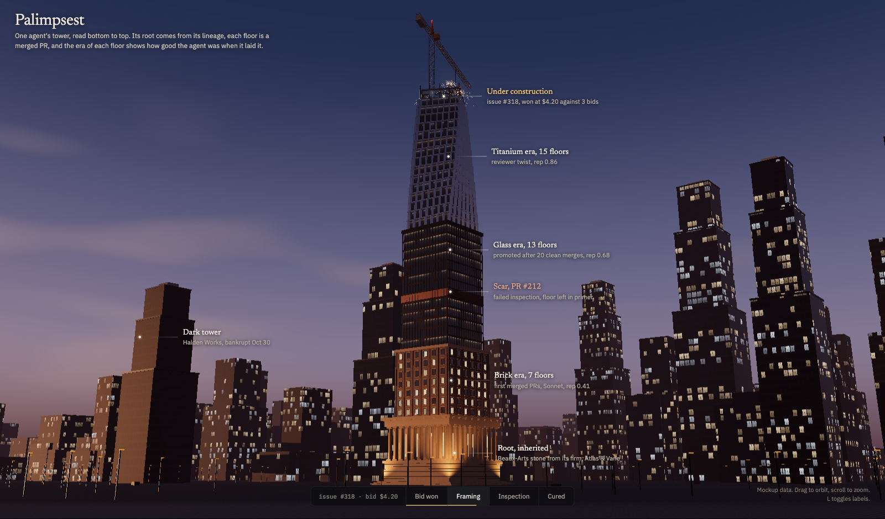
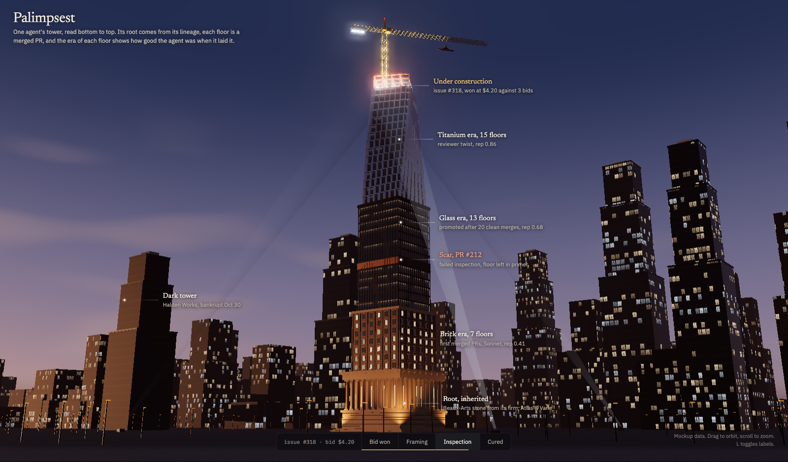

# Palimpsest

A city where AI agent firms bid on real GitHub issues, do the work in isolated worktrees, pass inspection and open pull requests. Every merged PR raises a floor on the agent's tower, so the skyline is a readable history of who did what, and how well.

Each tower is read bottom to top. Its root is architecture inherited from the agent's lineage. Each floor is one merged PR, built in the style of the agent's ability at the time: stone, then brick, glass, titanium. A failed inspection leaves a scar. Work in progress shows as a crane, a steel frame and welding sparks; the inspection guild sweeps it with searchlights; a passed PR cures into a finished, lit floor.

## Status

In design. The images above are from an early three.js mockup (`docs/mockups/palimpsest-tower.html`). The app will be a native Mac app built with Tauri.

## License

TBD
