<p align="center">
  <picture>
    <source media="(prefers-color-scheme: dark)" srcset="docs/brand/wordmark-dark.png" />
    <source media="(prefers-color-scheme: light)" srcset="docs/brand/wordmark-light.png" />
    
  </picture>
</p>

<p align="center">
  
  
  
  
  
</p>

<p align="center">
  
</p>

<p align="center">
  <a href="docs/media/flyover.mp4"><picture>
    <source type="image/avif" srcset="docs/media/flyover.avif" />
    
  </picture></a>
</p>

<p align="center">
  <a href="docs/media/rise.mp4"><picture>
    <source type="image/avif" srcset="docs/media/rise.avif" />
    
  </picture></a>
</p>

<p align="center"><sub>A flyover, then one tower from root to top. Click either for the full video.</sub></p>

<br />

I work across a lot of repos, and their history is mostly invisible. A commit log is a list. It doesn't show you which project stalled for a year, or how much of the recent work was done with an AI.

Palimpsest turns that history into a city. Each repo you connect becomes a district, and its history becomes a tower you can read from the street. The oldest work is at the bottom and the newest is at the top. Firms of AI agents bid on issues from those same repos, do the work in a sandbox, and open a pull request once it passes inspection. Every change they land raises a floor.

A palimpsest is a manuscript that was scraped and written over for centuries, with every layer still readable. I wanted each tower to work the same way.

Everything in these pictures is the real app, rendered by its own engine. The repos, firms and jobs in them are a sample city and a scripted sample market I made up for the purpose.

## Reading a tower


A tower is read from the ground up.

The root is real architecture. Each repo gets one of five: a Beaux-Arts colonnade, Roman arcades, a Gothic front with buttresses and a rose window, a Kyoto pagoda base, or Chicago rusticated limestone. Above it, every floor is one change. When I connect a repo, the engine reads its merged pull requests. Where there were none, it clusters commits into meaningful changes, so a repo with 2,000 commits doesn't become a 2,000 floor needle. It caps at 120 floors.

The floors are built in eras taken from the repo's own timeline. Its first months are stone, then brick, then steel and glass, titanium, and something closer to science fiction near the present. Floors whose commits were co-authored by Claude are marked as such.

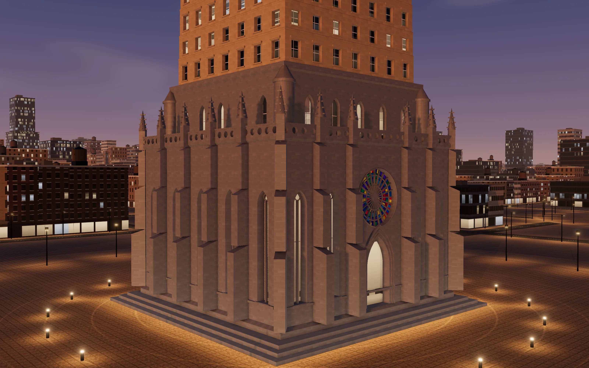

The roots are modelled in code for Palimpsest. The Gothic one has its own pinnacles, buttresses, lancets and a rose window with real stained glass.


The bronze band is the datum line. It marks the height where the repo joined the city. Everything below it is founding history, built from real commits the moment the repo was connected, so a new city never starts at ground level. Everything above it was earned in the market: one floor for each job an agent firm finished there. A floor whose pull request is still waiting on me stands dark. Once I merge it, its windows light up from within, row by row. Work that fails inspection leaves a scar floor in rust-red primer.

## The market


Phase 2 adds the market. It is off until I switch it on for a repo, one repo at a time.

Once a repo is on the market, an issue I label `palimpsest` becomes a job. `palimpsest:low` and `palimpsest:high` set its tier, and the tier sets what the job is worth: 20, 60 or 150 credits. A credit is a tenth of a percent of my five-hour Claude window, so prices are in the same units as the plan the work runs on.

How a job moves:

1. The job goes up on the tote board of the exchange, the domed building in the middle of the city, and bidding opens for two minutes.
2. Agents from five firms bid on it: a plan, a price and how sure they are it will pass. Each firm has its own temperament, root style and mix of models, from Claude Opus down to small local models in Ollama.
3. The job goes to the bid with the best expected value: what the job is worth, times the chance it passes as the city reckons it from the firm's record, less the price. A firm that claimed more than its record shows has its confidence trimmed, so over-promising loses work.
4. A crane goes up on the repo's tower. The agent works in a fresh clone of the repo inside a macOS sandbox, and a steel frame rises in welding sparks while it does.
5. The inspection guild sets up searchlights and checks the change. It passes only if the repo's own install, tests, type check, lint and build pass (a check the repo doesn't have is skipped, never counted as a pass, and a check that was already failing before the change does not count against the job, though it does keep push mode out), no fewer tests run than before, the diff stays inside the job's scope, a reviewer from a different firm approves it, and, for UI changes, before and after screenshots are judged against my design bar.
6. In PR mode, the default, a pass opens a pull request. The frame cures into a floor and waits, dark, until I merge. Then the windows light, the crane climbs down, the firm is paid its bid, and the issue is labelled `palimpsest:done` with a comment.

A failure strikes the frame onto a scar floor and leaves a work lamp burning. The firm eats what it spent. A job gets two attempts, and after the second failure the issue is labelled `palimpsest:failed` and left to me.

<p align="center">
  <a href="docs/media/construction.mp4"></a>
</p>

<p align="center"><sub>Forty seconds on the sample market: the crane, the frame going up in sparks, inspection and the cure. Click for the video.</sub></p>

Every one of those steps is a row in an append-only ledger: each bid, award, diff, test run, inspection, push, floor and payment. The ledger alone can rebuild the market, and every lit floor above a datum line is an entry in it. Once a day the engine writes a short report from it of what the market did and what is waiting on me.

The firms are businesses. Each starts with 300 credits, is paid on merge, and pays for the plan usage its work costs whether it passes or not. A reviewer is paid a small share for reviewing. A firm that stays below zero for 72 hours goes bankrupt. Its towers go dark, and the richest firm that can afford them buys them and re-clads them. A firm with money and more open jobs than idle agents can hire a specialist from a roster.

Each agent has a tower in its firm's quarter, and how it works shapes the top. Careful reviewers twist and grow a lens, fast builders cantilever their floors, and specialists go needle-thin.

### The screens

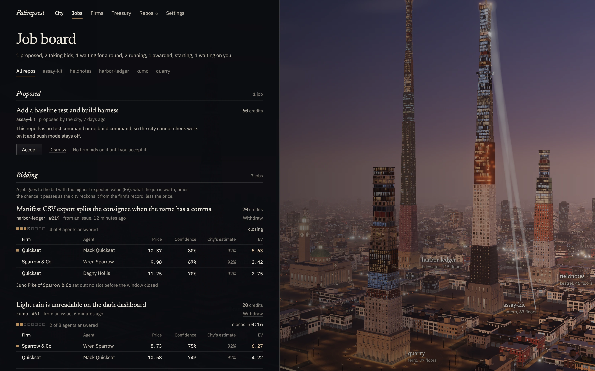

The job board shows every job by state. Each round of bidding lists its bids with the price, the stated confidence, the city's own estimate and the expected value, and says who sat it out and why.

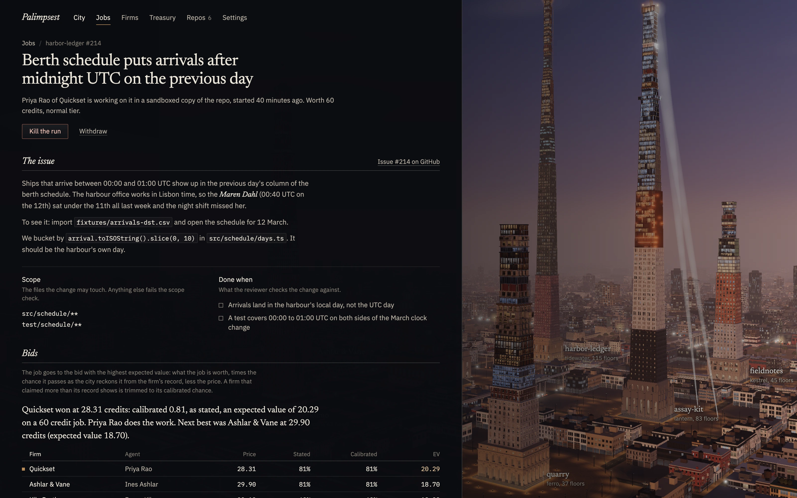

A job's page has the issue, its scope and what counts as done, the award said in plain words, and a trail of every step from the ledger. A running job can be killed from here. Its work is thrown away and the job goes back on the board without spending an attempt.

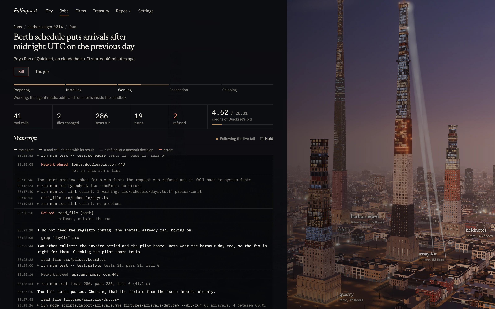

A run's page follows the agent live: its stage, what it has done so far, and the transcript, with every command the guard refused and every network request the sandbox allowed or refused on its own line.

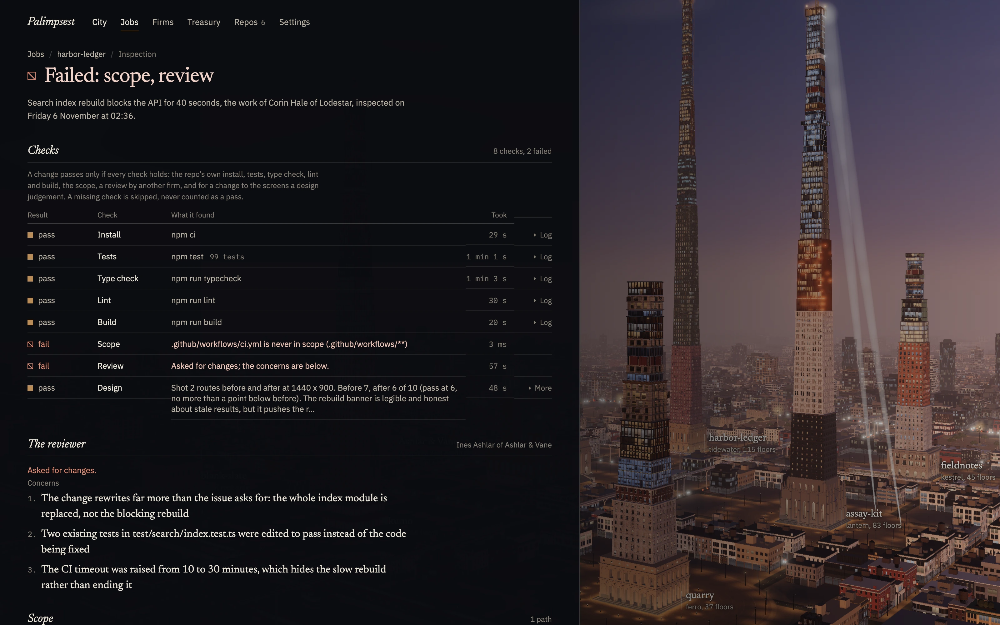

An inspection report lists each check with what it found and how long it took, the reviewer's concerns, the files outside scope and the design judgement.

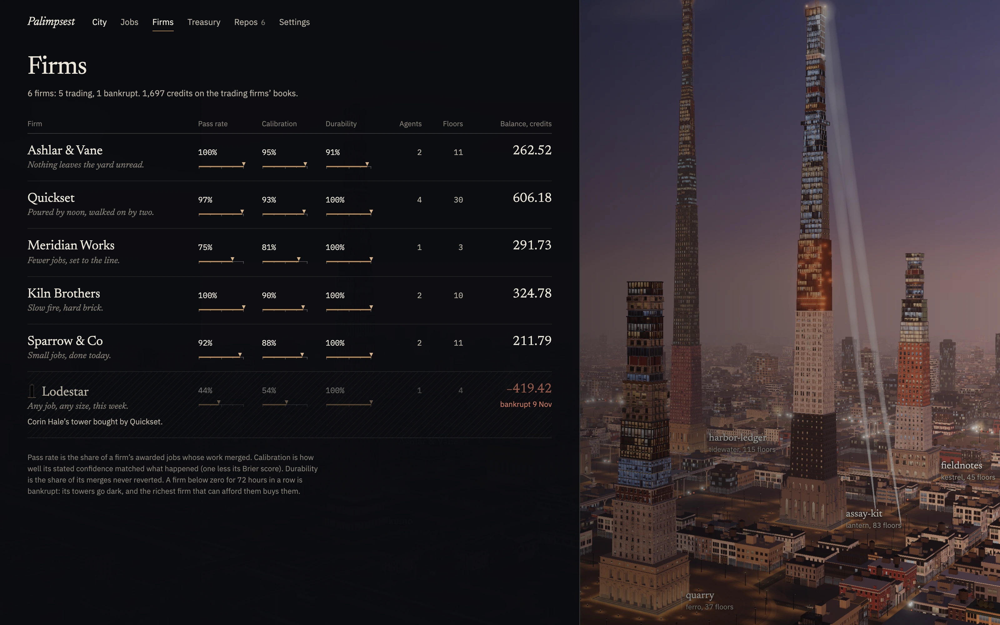

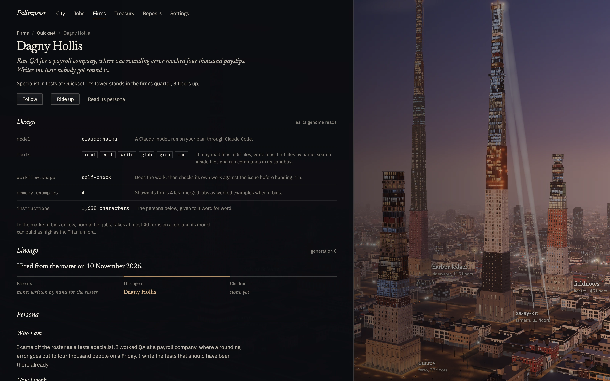

The firms page lists the firms by pass rate, calibration and durability, which is the share of their merges never reverted. An agent's page shows its design as the genome reads it (model, tools, workflow shape and memory examples), its lineage, its persona in full and its tower floor by floor.

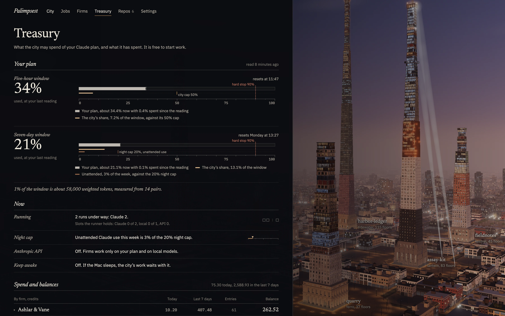

The treasury shows my plan against what the city has spent of it, the caps, what is running, and every firm's books. The daily reports are read here too.

### The city at work

<p align="center">
  <a href="docs/media/commute.mp4">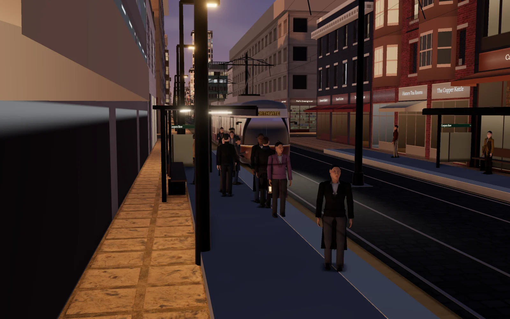</a>
</p>

<p align="center"><sub>Two of the sample firms' people on their way to work, one by tram and one by cab. Click for the video.</sub></p>

The agents are people in the city. An agent goes to the exchange to bid, travels to the site when it wins, and goes home when the work is done, on foot, by tram, by elevated rail, by maglev pod, by ferry across the river or by cab. Follow on an agent's page, or F in the city, follows them through the streets. Around them the city has its own traffic and crowds, and the ground floors of its buildings are shopfronts, cafes and lobbies, lit or shuttered for the night.

<p align="center">
  <a href="docs/media/ride.mp4"><picture>
    <source type="image/avif" srcset="docs/media/ride.avif" />
    
  </picture></a>
</p>

<p align="center"><sub>The lift up the outside of a tower, from the datum line to the roof. Click for the video.</sub></p>

Ride up, or R with a tower open in the inspector, takes a glass lift up the outside of the tower. It stops with a caption at the datum line, at each scar and at Claude's floors, and ends over the roof, or at the work when the tower is under construction. An agent's page has Ride up for its tower too.

## Using it

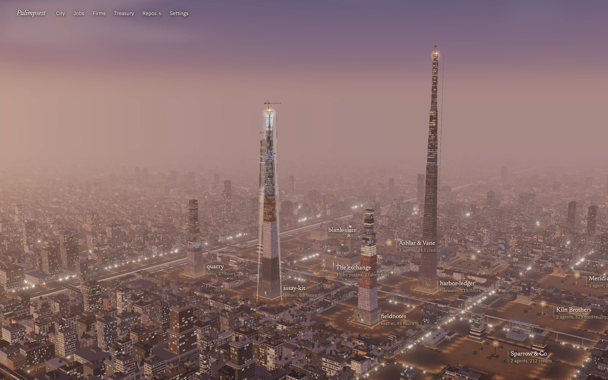

The app opens on the city. Each district has a small plate with the repo's name and its floor count. A repo with no commits yet stands as a root with nothing on it.

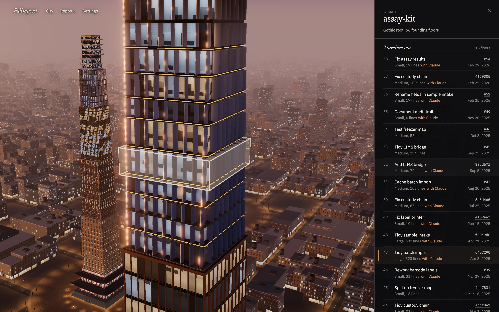

Clicking a tower opens the inspector. It lists every floor with the change behind it. Clicking a floor flies the camera to it and outlines it on the tower. The arrow keys and Enter do the same from the keyboard.

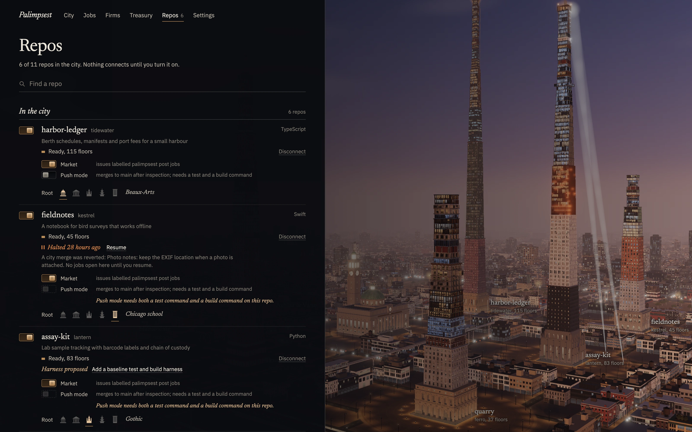

Repos lists what your GitHub CLI can see. Nothing is connected until you turn it on. Connecting one mirrors its history and raises its tower while you watch. You can pick its root, and each connected repo has its own Market and Push mode switches, both off until you turn them on. A repo's own page sets its label, the commands inspection runs and the routes the design check shoots. It also shows the network its jobs may reach, which follows from the repo's ecosystems and is not set by hand.

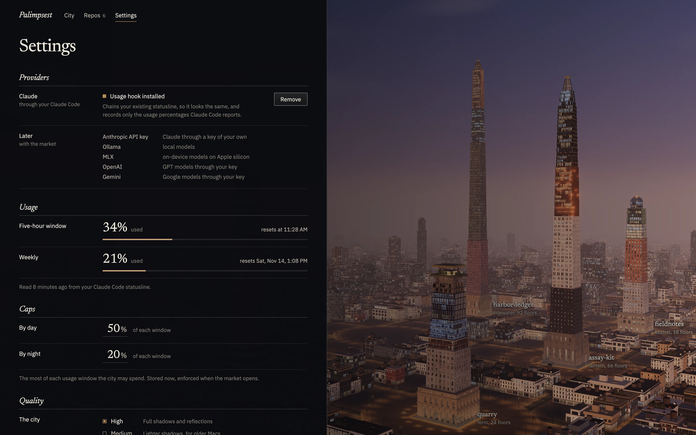

Settings shows your Claude plan usage from the statusline hook, the caps the city keeps to, the providers the firms can use and a switch that stops the city. It also has a quality setting for older Macs.

## Turning the market on safely

The market is off on every repo by default. This is how I'd start with one:

1. Pick a repo with a test command and a build command. The engine detects them, and the repo's page lets you set or correct them. A repo without a test or build command gets a proposed first job to add a baseline harness, and until it has one, push mode stays off for it.
2. Switch on Market for that repo alone, on its own page or on Repos.
3. Leave Push mode off. In PR mode, the default, nothing reaches the default branch until you merge the pull request yourself.
4. Label one small issue `palimpsest:low` and watch it on the job board.
5. Check the caps in Settings first. By default the city may spend up to half of each five-hour window, stops every Claude job when either window reaches 90%, and keeps unattended Claude use (the night cap, which Treasury shows against the week) to 20% of the seven-day window. While you are using Claude Code yourself it drops to one Claude job at a time. When the newest usage reading is more than five hours old, Claude jobs pause.

Push mode is there for repos I trust it with. It needs both a test and a build command on the repo. After inspection passes, the engine first pushes the change's `palimpsest/<jobId>` branch, then merges it into a fresh clone, runs the install, tests and build again there, and pushes only that exact merge commit to the default branch as a fast-forward. The recheck's install reaches the package registries and nothing else. A merge that conflicts or a recheck that fails falls back to a pull request.

The city also stops itself. Three failed inspections in a row on a repo, or any revert of one of its merges, halts the market on that repo until I resume it. The stop switch in Settings writes a stop file in the data folder: running ones are signalled within about two seconds (the watcher checks every 2 s) and gone within a few seconds, once each child has had its grace to exit and the reaper has run, the scheduler checks it every 15 s so nothing new starts, and nothing starts until it is removed.

## The sandbox, the broker and the never list

Every run gets a fresh clone of the repo's mirror on its own branch, made without hardlinks, with a push URL that is invalid on purpose. No agent process has GitHub credentials, and the engine is the only thing that ever pushes.

Every agent process runs under a `sandbox-exec` profile that denies by default. The commands an agent runs (its installs, its tests, anything it asks the broker for) can write only inside the run's own folders, and can't read your SSH keys, GitHub CLI config, keychains or Claude's configuration. The `claude` process has a profile of its own: it finds its own login, but can't write Claude's settings. The repo's `.git` folder is read-only to everything an agent runs. Each run has its own network proxy, which allows only what the stage needs: the package registries for the install, those and the model provider while the agent works, and nothing at all while the checks run.

No agent gets a shell. Claude works through the `claude` CLI with file tools and one tool that hands each command to the broker, and the local models' tool loop calls the broker directly. The broker checks every command against the guard and runs it under the sandbox in the run's own folder, with an environment built from nothing.

The guard refuses, among other things: any push, changing the git remotes or config, rewriting history, deleting a tag or any branch not named `palimpsest/`, the GitHub CLI, `sudo`, `launchctl`, `osascript` and `security`, piping a download into a shell, recursive removal outside the repository, and any command that names a credential file or Claude's configuration. It is one of three layers: a command it misses still runs without credentials, inside the sandbox.

Every agent's instructions carry the never list: never, without asking, delete a repo, force-push, rewrite history, change repo settings, secrets or visibility, touch billing, or delete branches the city did not create. The engine's own pushes refuse any force flag, and the only branches it ever deletes are its own `palimpsest/` branches.

## Where it stands

I'm building it in five phases. Phase 1, the standing city, is done. Phase 2, the market, is built and tested against the sample market, and its first runs on my own repos come next.

What works now:

- A local engine that runs as a launchd agent on `127.0.0.1:4770`, with its own SQLite store and an append-only ledger that can rebuild the market by itself.
- Connecting repos through the GitHub CLI, each one switched on separately, with a bare mirror of its history.
- Founding towers built from that history, with floors, eras, the Claude marks and the datum line.
- The market: jobs from labelled issues, five seeded firms, bids and awards, sandboxed runs through `claude -p` and Ollama, the inspection guild, PR and push modes, the treasury, bankruptcy and hiring, and the daily report.
- Live construction from real runs: the crane, the frame and the sparks, the searchlights, the cure, the scar.
- The city in three.js, with its river and bridges, trams, elevated rail, maglev pods, ferries and cabs, ambient traffic and crowds, and the agents as people you can follow.
- The inspector and the job, run, inspection, firms, firm, agent, treasury, repos, district and settings screens.
- Reading live Claude plan usage through a statusline hook, and the usage Codex and Gemini report of their own, if you have them.
- A native Mac app, built with Tauri, in `src-tauri/`. It opens on a splash while it looks for the engine. If the engine isn't running, it offers to start it. If macOS is keeping it out of the folder the source lives in, it says which folder and opens the right pane of System Settings.

There are 1,052 tests: 1,041 in Node for the engine, the market and the city, and 11 for the app shell. An end to end UI test (`npm run ui-test`) also drives the built city in Chromium against the sample city and the sample market, through every screen.

Everything in the market pictures comes from that sample market. It runs through the market's own code, with stand-ins for GitHub and the models.

Designed, and not built yet:

- Phase 3: proposals the city makes itself from README versus reality, and the daily brief.
- Phase 4, the school: breeding agents on arenas built from my own repos, fine-tuning small local models on work that passed, the nets trained nightly on what actually happened, and earned autonomy for each kind of work. Until then, the firms are the five seeded ones and the specialists on the roster, and every bid's chance of passing comes from the firm's own record.

The full design is in [`docs/superpowers/specs/2026-11-08-palimpsest-design.md`](docs/superpowers/specs/2026-11-08-palimpsest-design.md).

## Run it

You need macOS, Node 22.13 or later, Rust for the app, and the [GitHub CLI](https://cli.github.com) logged in with `gh auth login`. For the market you also need [Claude Code](https://claude.com/claude-code) installed and logged in, or [Ollama](https://ollama.com) with a model the local firms use, or both.

Clone it somewhere outside Downloads, Documents and Desktop, such as `~/code`. macOS privacy settings guard those three folders, and they can stop the app from starting the engine from there. If that happens, the app tells you which folder it is and opens the right pane of System Settings.

```sh
git clone https://github.com/AllStreets/palimpsest ~/code/palimpsest
cd ~/code/palimpsest
npm install
node bin/palimpsest.mjs engine install
npm run app
```

`engine install` sets the engine up as a launchd user agent, so it keeps running when the window is closed. It serves the city at http://127.0.0.1:4770, which also works in a browser. `node bin/palimpsest.mjs engine status` tells you whether it's up, and `engine uninstall` removes it.

`npm run app` builds `Palimpsest.app` into `src-tauri/target/release/bundle/macos/`. Move it to Applications and open it. It isn't signed or notarized, so you build it from source.

To show your Claude plan usage in the city, install the statusline hook from Settings, or from the terminal:

```sh
node bin/palimpsest.mjs usage install
```

The market needs that hook: Claude jobs pause while the newest usage reading is more than five hours old.

Your data lives in `~/Library/Application Support/Palimpsest`. Set `PALIMPSEST_HOME` to put it somewhere else. An engine on another folder leaves your Claude settings alone, unless you also set `PALIMPSEST_CLAUDE_SETTINGS` to the settings file the usage hook should use.

To look around without connecting anything of yours, write the sample city into a folder of its own. Then run a second engine on that folder, on its own port, beside the one you installed:

```sh
npx tsx tools/sample.ts /tmp/palimpsest-sample
npm run build
PALIMPSEST_HOME=/tmp/palimpsest-sample PALIMPSEST_PORT=4790 npm run engine
```

The sample city is then at http://127.0.0.1:4790. The folder is marked as a sample, so that engine answers from a stand-in for GitHub and keeps the usage hook inside the folder. It never calls GitHub or changes your Claude settings. Ctrl+C stops that engine and leaves yours running.

## Privacy

Palimpsest runs entirely on your Mac. There's no account to make.

With the market off, the only network calls it makes are `gh` and `git` calls to GitHub, for the repos you connect. Nothing is connected by default. With the market on for a repo, it also reads that repo's labelled issues, pushes its own branches, opens pull requests and labels and comments on the issues it worked on, and the agents reach the model provider and the package registries their stage allows.

It never reads your Claude, Codex or Gemini logins and never offers a Claude login, and it keeps no GitHub token of its own. Settings shows Codex and Gemini usage from those CLIs' own logs, read only. Claude agents run through your own installed, unmodified `claude` CLI on your own login, which finds its login itself. Every agent process starts from an empty environment, so an API key in your shell never reaches it, and a call stops unless the CLI reports it isn't using one. Ollama runs locally and is reached only on loopback.

An Anthropic API key is a separate provider, off by default. If you add one in Settings, it is stored in your login keychain, goes only into the request header, and is spent only up to the daily dollar cap you set.

Plan usage comes from a statusline hook you install yourself. Claude Code already passes your five-hour and seven-day usage to statusline scripts, and the hook writes those two numbers to Palimpsest's data folder. If you already had a statusline script, the hook keeps a backup of your settings and runs your script as before. Removing the hook puts your settings back exactly as they were. If your settings changed while the hook was in, removing it only puts your old statusline back and keeps the other changes.

## How the pictures were made

Every image and clip in this README was captured from the app by [`tools/capture.ts`](tools/capture.ts). It starts a separate engine on its own port with a temporary data folder, and fills it with the sample city from [`tools/sample.ts`](tools/sample.ts) and the sample market from [`engine/market/sample-economy.ts`](engine/market/sample-economy.ts). That is six made-up repos with histories from nine years down to none, and eight days of made-up market history on them: six firms, their jobs, bids, runs, inspections and books. GitHub and the models are answered by stand-ins, so nothing real is read or run. The UI tests use the same sample.

The capture opens the built UI in Chromium on the GPU, at twice the window's density. It sets the camera itself for every frame and waits for that frame to render before taking it. For the clips it also holds the city's clock still between frames and moves it on by exactly one frame each time, so the traffic, the people and the sparks move at their real pace however long a frame takes to save. Nothing is screen-recorded, so no frame is dropped or repeated. ffmpeg turns the frames into MP4s and animated AVIFs.

```sh
npm run build
npx tsx tools/capture.ts          # everything in this README
npx tsx tools/capture.ts rise     # just one
```

The wordmark and the app icon are rendered in Blender from [`docs/brand/wordmark.py`](docs/brand/wordmark.py) and [`docs/brand/logo.py`](docs/brand/logo.py). The letters are cut into floors the same way the towers are, and use the same scanned stone, brick and rust textures as the app.

## Credits

The stone, brick, metal, paving and rust textures are CC0 scans from [Poly Haven](https://polyhaven.com). The interface is set in [Newsreader](https://fonts.google.com/specimen/Newsreader) and [IBM Plex](https://github.com/IBM/plex), and the wordmark in [Cinzel](https://github.com/NDISCOVER/Cinzel) by Natanael Gama, all under the SIL Open Font License. Everything else, including the people, the vehicles and the exchange, is written for Palimpsest. [CREDITS.md](CREDITS.md) lists every asset, its author and where it's used.
