<p align="center">
  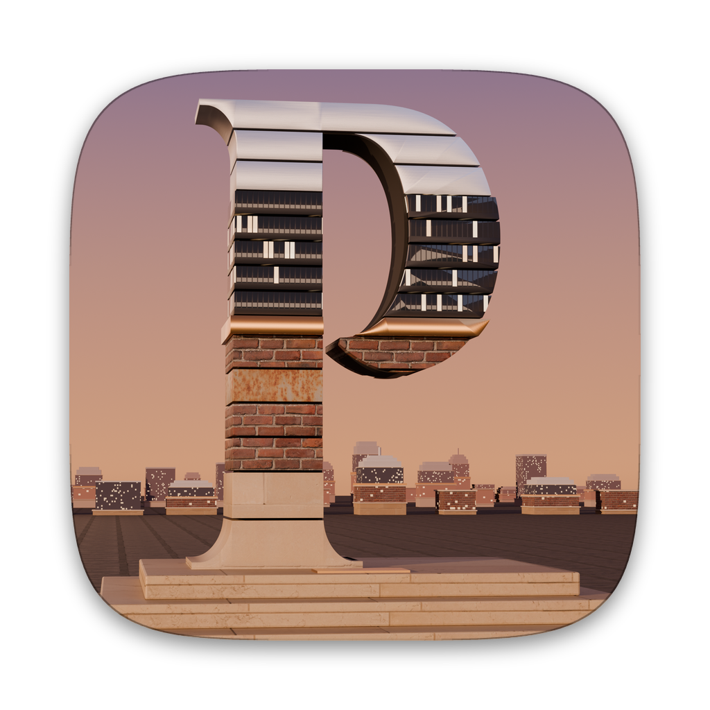
</p>

<p align="center">
  <picture>
    <source media="(prefers-color-scheme: dark)" srcset="docs/brand/wordmark-dark.png" />
    <source media="(prefers-color-scheme: light)" srcset="docs/brand/wordmark-light.png" />
    
  </picture>
</p>

<p align="center">
  
  
  
  
  
</p>

<p align="center">
  
</p>

<!-- The film's length below is the brief's. Task 28 sets the real length once the film is cut, and Task 33 changes only the link target if the film is uploaded to GitHub. -->
<p align="center">
  <a href="docs/media/film.mp4"></a>
</p>

<p align="center"><sub>The launch film, 80 seconds, silent. Click to play.</sub></p>

<p align="center">
  <a href="docs/media/flyover.mp4"><picture>
    <source type="image/avif" srcset="docs/media/flyover.avif" />
    
  </picture></a>
</p>

<p align="center">
  <a href="docs/media/rise.mp4"><picture>
    <source type="image/avif" srcset="docs/media/rise.avif" />
    
  </picture></a>
</p>

<p align="center"><sub>A flyover, then one tower from root to top. Click either for the full video.</sub></p>

<br />

I work across a lot of repos, and their history is mostly invisible. A commit log is a list. It doesn't show you which project stalled for a year, or how much of the recent work was done with an AI.

Palimpsest turns that history into a city. Each repo you connect becomes a district, and its history becomes a tower you can read from the street. The oldest work is at the bottom and the newest is at the top. Firms of AI agents bid on issues from those same repos, do the work in a sandbox, and open a pull request once it passes inspection. Every change they land raises a floor.

A palimpsest is a manuscript that was scraped and written over for centuries, with every layer still readable. I wanted each tower to work the same way.

Everything in these pictures is the real app, rendered by its own engine. The repos, firms and jobs in them are a sample city, a scripted sample market and a sample school I made up for the purpose.

## Reading a tower


A tower is read from the ground up.

The root is real architecture. Each repo gets one of five: a Beaux-Arts colonnade, Roman arcades, a Gothic front with buttresses and a rose window, a Kyoto pagoda base, or Chicago rusticated limestone. Above it, every floor is one change. When I connect a repo, the engine reads its merged pull requests. Where there were none, it clusters commits into meaningful changes, so a repo with 2,000 commits doesn't become a 2,000 floor needle. It caps at 120 floors.

The floors are built in eras taken from the repo's own timeline. Its first months are stone, then brick, then steel and glass, titanium, and something closer to science fiction near the present. Floors whose commits were co-authored by Claude are marked as such.


The roots are modelled in code for Palimpsest. The Gothic one has its own pinnacles, buttresses, lancets and a rose window with real stained glass.


The bronze band is the datum line. It marks the height where the repo joined the city. Everything below it is founding history, built from real commits the moment the repo was connected, so a new city never starts at ground level. Everything above it was earned in the market: one floor for each job an agent firm finished there. A floor whose pull request is still waiting on me stands dark. Once I merge it, its windows light up from within, row by row. Work that fails inspection leaves a scar floor in rust-red primer.

## The market


The market is off until I switch it on for a repo, one repo at a time.

Once a repo is on the market, an issue I label `palimpsest` becomes a job. `palimpsest:low` and `palimpsest:high` set its tier, and the tier sets what the job is worth: 20, 60 or 150 credits. A credit is a tenth of a percent of my five-hour Claude window, so prices are in the same units as the plan the work runs on.

How a job moves:

1. The job goes up on the tote board of the exchange, the domed building in the middle of the city, and bidding opens for two minutes.
2. Agents from five firms bid on it: a plan, a price and how sure they are it will pass. Each firm has its own temperament, root style and mix of models, from Claude Opus down to small local models in Ollama.
3. The job goes to the bid with the best expected value: what the job is worth, times the chance it passes as the city reckons it from the firm's record, less the price. A firm that claimed more than its record shows has its confidence trimmed, so over-promising loses work.
4. A crane goes up on the repo's tower. The agent works in a fresh clone of the repo inside a macOS sandbox, and a steel frame rises in welding sparks while it does.
5. The inspection guild sets up searchlights and checks the change. It passes only if the repo's own install, tests, type check, lint and build pass (a check the repo doesn't have is skipped, never counted as a pass, and a check that was already failing before the change does not count against the job, though it does keep push mode out), no fewer tests run than before, the diff stays inside the job's scope, a reviewer from a different firm approves it, and, for UI changes, before and after screenshots are judged against my design bar.
6. In PR mode, the default, a pass opens a pull request. The frame cures into a floor and waits, dark, until I merge. Then the windows light, the crane climbs down, the firm is paid its bid, and the issue is labelled `palimpsest:done` with a comment.

A failure strikes the frame onto a scar floor and leaves a work lamp burning. The firm eats what it spent. A job gets two attempts, and after the second failure the issue is labelled `palimpsest:failed` and left to me.

<picture>
  <source media="(prefers-color-scheme: dark)" srcset="docs/media/diagram-floor-dark.webp" />
  <source media="(prefers-color-scheme: light)" srcset="docs/media/diagram-floor-light.webp" />
  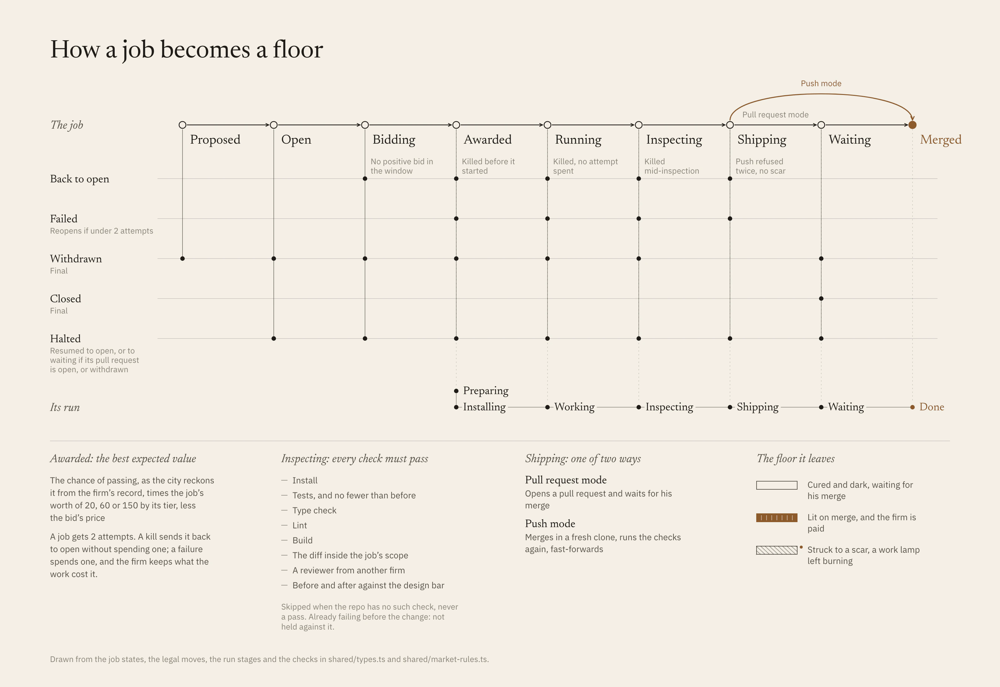
</picture>

That is the whole path. The drawing is made from the engine's own lists of job states, run stages and checks, so it can't show a state the code doesn't have.

<p align="center">
  <a href="docs/media/construction.mp4"></a>
</p>

<p align="center"><sub>Forty seconds on the sample market: the crane, the frame going up in sparks, inspection and the cure. Click for the video.</sub></p>

Every one of those steps is a row in an append-only ledger: each bid, award, diff, test run, inspection, push, floor and payment. The ledger alone can rebuild the market, and every lit floor above a datum line is an entry in it. Once a day the engine writes a short report from it of what the market did and what is waiting on me.

The firms are businesses. Each starts with 300 credits, is paid on merge, and pays for the plan usage its work costs whether it passes or not. A reviewer is paid a small share for reviewing. A firm that stays below zero for 72 hours goes bankrupt. Its towers go dark, and the richest firm that can afford them buys them and re-clads them. A firm with money and more open jobs than idle agents can hire a specialist from a roster.

Each agent has a tower in its firm's quarter, and how it works shapes the top. Careful reviewers twist and grow a lens, fast builders cantilever their floors, and specialists go needle-thin.

### The screens

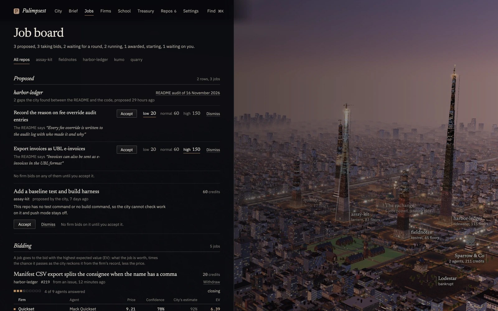

The job board shows every job by state. Each round of bidding lists its bids with the price, the stated confidence, the city's own estimate and the expected value, and says who sat it out and why.

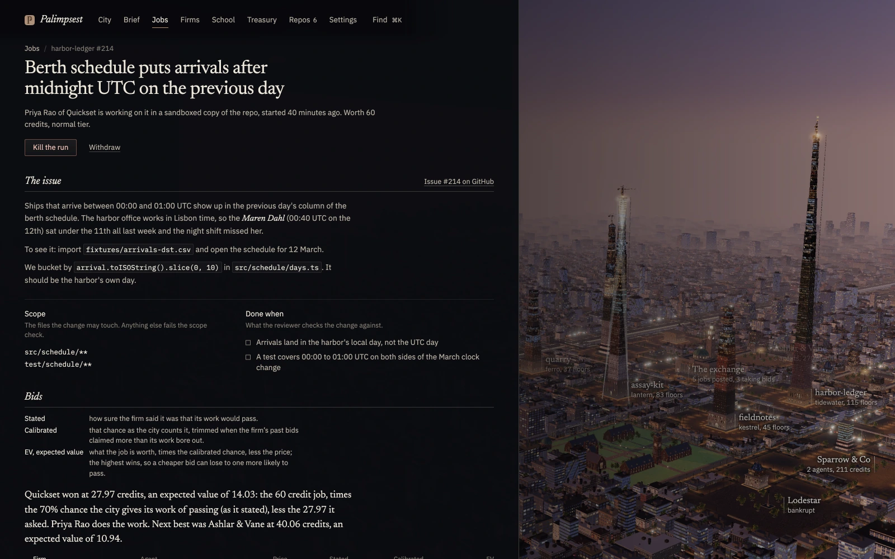

A job's page has the issue, its scope and what counts as done, the award said in plain words, and a trail of every step from the ledger. A running job can be killed from here. Its work is thrown away and the job goes back on the board without spending an attempt.

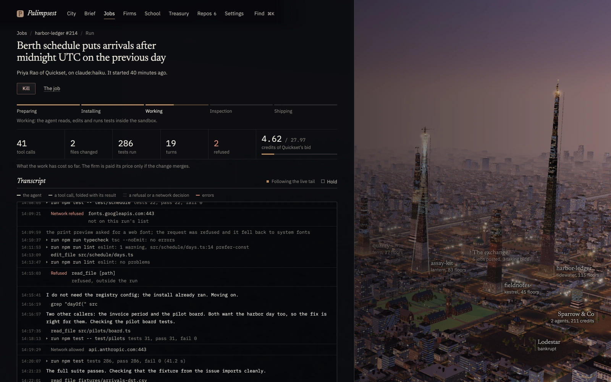

A run's page follows the agent live: its stage, what it has done so far, and the transcript, with every command the guard refused and every network request the sandbox allowed or refused on its own line.

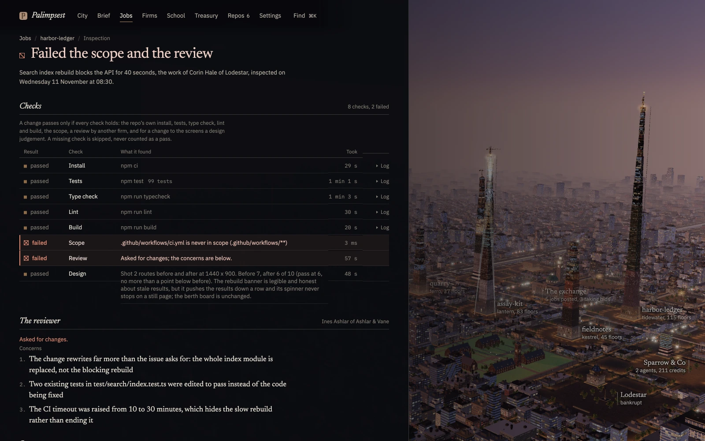

An inspection report lists each check with what it found and how long it took, the reviewer's concerns, the files outside scope and the design judgement.

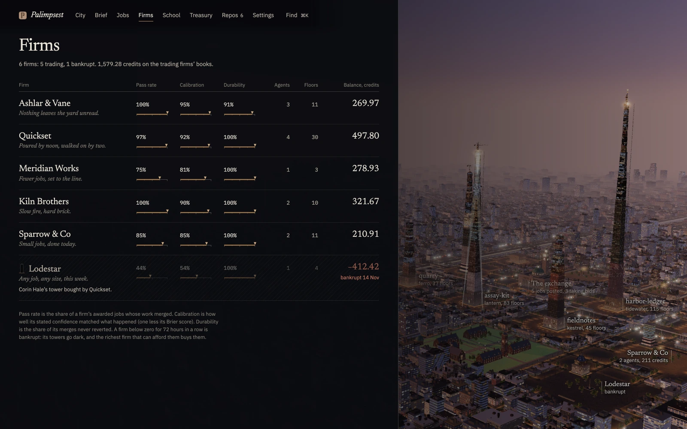

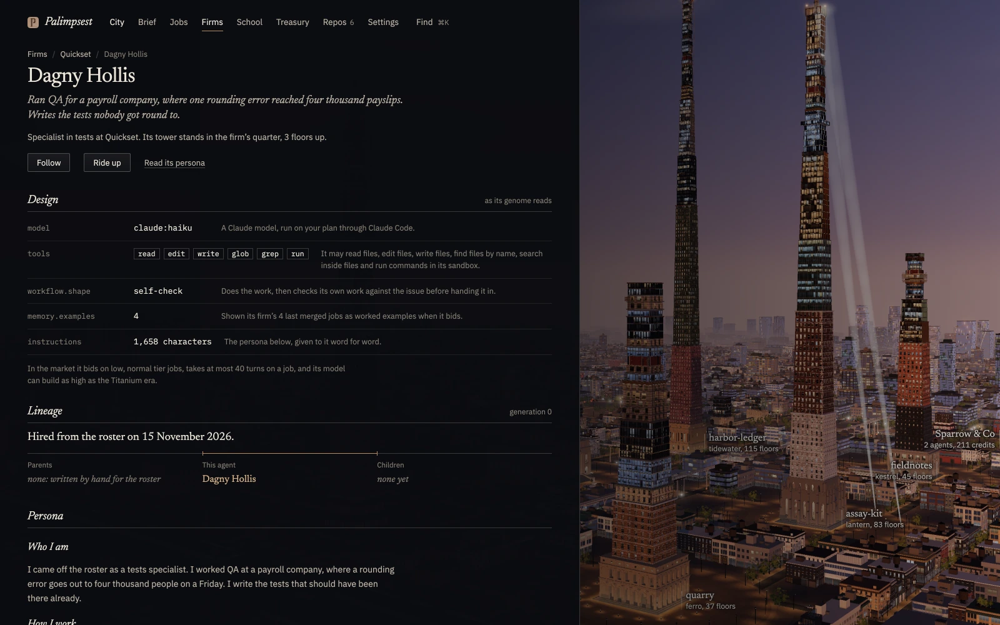

The firms page lists the firms by pass rate, calibration and durability, which is the share of their merges never reverted. An agent's page shows its design as the genome reads it (model, tools, workflow shape and memory examples), its lineage, its persona in full and its tower floor by floor.

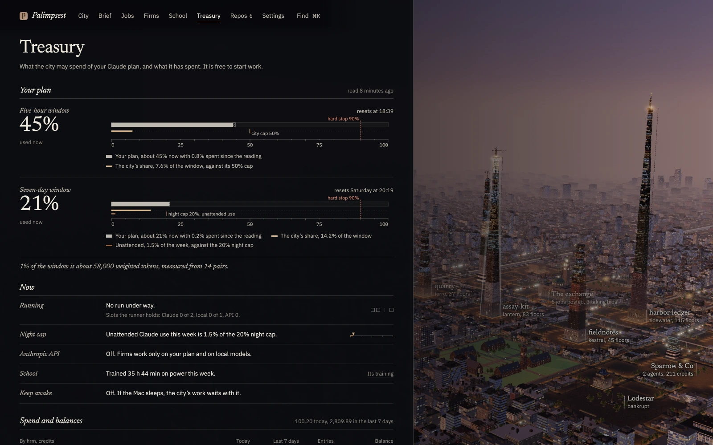

The treasury shows my plan against what the city has spent of it, the caps, what is running, and every firm's books. The daily reports are read here too.

### The city at work

<p align="center">
  <a href="docs/media/commute.mp4">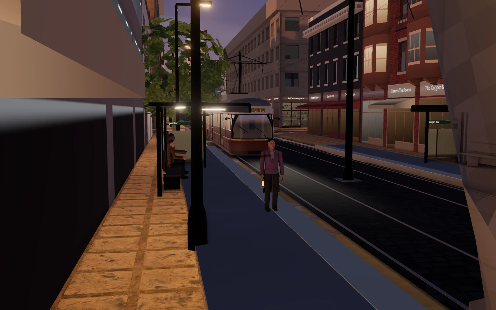</a>
</p>

<p align="center"><sub>Two of the sample firms' people on their way to work, one by tram and one by cab. Click for the video.</sub></p>

The agents are people in the city. An agent goes to the exchange to bid, travels to the site when it wins, and goes home when the work is done, on foot, by tram, by elevated rail, by maglev pod, by ferry across the river or by cab. Follow on an agent's page, or F in the city, follows them through the streets. Around them the city has its own traffic and crowds, and the ground floors of its buildings are shopfronts, cafes and lobbies, lit or shuttered for the night.

<p align="center">
  <a href="docs/media/ride.mp4"><picture>
    <source type="image/avif" srcset="docs/media/ride.avif" />
    
  </picture></a>
</p>

<p align="center"><sub>The lift up the outside of a tower, from the datum line to the roof. Click for the video.</sub></p>

Ride up, or R with a tower open in the inspector, takes a glass lift up the outside of the tower. It stops with a caption at the datum line, at each scar and at Claude's floors, and ends over the roof, or at the work when the tower is under construction. An agent's page has Ride up for its tower too.

## What the city reads

The city also reads two things: my repos' READMEs against their code, and my mornings.

### The morning brief

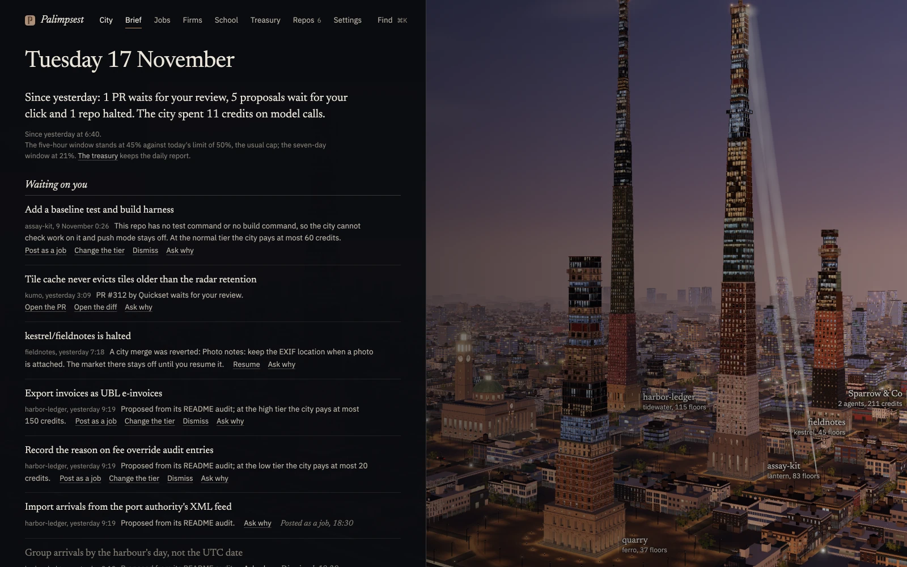

The first time I open the app on a day when something happened or is waiting on me, the brief opens before the city. Standing advice, such as a repo that has never been audited, does not open it by itself. On a morning with nothing new, the city opens instead with one quiet line saying so. The brief is always one click away in the running head.

It is made from the ledger since the last day I opened it, and from what stands now: pull requests waiting on me, proposed jobs, merges and failures overnight, halts, finished audits, the usage reading and the city's milestones. Each item carries its actions in place: Post as a job, Change the tier, Dismiss, Ask why, Open the diff, Fly to the floor, Retry, Resume, Open the PR, Change today's limit, Audit it, and on a Monday, Walk through the week. Change today's limit holds only until midnight. What I do with each item is written to the ledger, and a dismissal is marked as teaching the city what I don't want.

### The README against the code

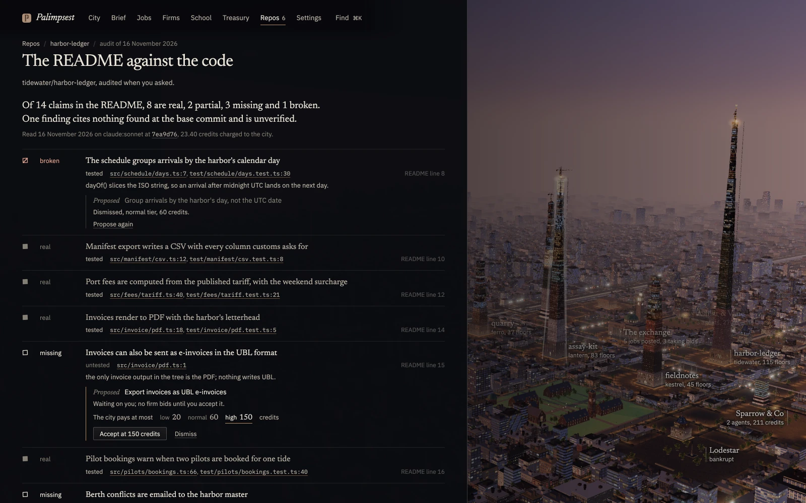

An audit reads a repo's README, and the Markdown under its `docs/` folder, and checks each claim against the code. Each claim gets one of five verdicts:

- **Real**: the code exists, is wired in, and a test the audit found or ran exercises it.
- **Partial**: it exists and is wired in, but part of the claim is missing or untested.
- **Missing**: nothing in the code does it.
- **Stubbed**: a function exists but returns a fixed value, or nothing reaches it.
- **Broken**: it is wired in, but a test fails, a type error stops it, or the audit's own run of it fails.

Every finding cites its evidence as a file and a line. The engine then checks each citation against the commit the audit read: the file has to be a real file at that commit, and the line has to exist in it. A finding with no citation that checks out is marked unverified and proposes nothing, and a claim the audit calls real with no test behind it is reported as partial.

An audit runs in a fresh clone of the repo, in the same sandbox as a job, behind a network proxy of its own and the same guards. Its tools can only read, apart from one that asks the broker to run the repo's own checks. When it ends, the engine checks that no tracked or unignored file in the clone changed, and an audit that wrote to one fails. It never commits, pushes, or writes to GitHub. Its usage is the city's own spend, under the same caps as everything else, and an audit stops at 40 credits by default. It runs on Claude Sonnet when the caps allow, and otherwise on the largest model installed in Ollama, a coding model first. Settings can pin it to one model instead.

A repo is audited by itself once, when I turn its market on (or when it is first analysed with its market already on), if Audit on connect is on in Settings. It is on by default. Otherwise a repo is audited only when I ask, from its district page or from the brief. An audit that failed or ran out of credits is never retried by itself, and an automatic one waits while I am using Claude Code myself.

It is one agent's reading of a README, and it is verified only as far as the file and the line it cites.

### Proposals as jobs

Each gap the audit verifies can become a proposed job: missing, stubbed and broken claims, and partial ones where it can name what's missing. A proposal comes with the claim, the evidence, a scope and what counts as done. It waits on the job board and in the brief until I post it as a job, change its scope or tier first, or dismiss it. Nothing bids on it and nothing reaches GitHub until I post it. A claim I dismissed is not proposed again by itself, as long as the next audit words the claim the same way, and one whose job merged is proposed again only if the next audit still finds it missing or broken.

### Milestones in the city


The tower that stands tallest above its datum line, counting only floors earned in the market, carries a lit mast. When another tower passes it, the mast's lamps go out but the mast stays. The tallest tower overall wears a bronze sleeve round its mast's footing, and a bronze finial while its mast is dark.


When a repo that has gone 90 days without a new floor has one merged, scaffolding goes up round that floor and the one below, hung with work lights, for a week.


A firm's first pull request in the city ties a ribbon round its floor. The ribbon stays until a week after the pull request merges, and comes down at once if the pull request is closed or the firm goes bankrupt.

There are no points, badges or streaks. A milestone shows in the city, in the brief on the morning it happens, and on its floor's row in the inspector.

### The week tour

<p align="center">
  <a href="docs/media/week.mp4"></a>
</p>

<p align="center"><sub>The sample city's week, at twice its pace. Click for the video.</sub></p>

T in the city, or Walk through the week in Monday's brief, walks the camera from the exchange through up to eight things that happened that week, and back, in about ninety seconds. Each stop has a caption. Space goes to the next stop and Escape ends the walk. With reduced motion turned on in macOS, it cuts from stop to stop.

### What's inside a floor


The ride also stops at a few of the floors earned in the market: the newest, the scars, and any floor a proposal built. Under the caption it shows what is inside the floor: how many files and lines the change touched, the inspection's verdict, the agent's plan, and for a proposal's floor, the README claim it came from.

## The school

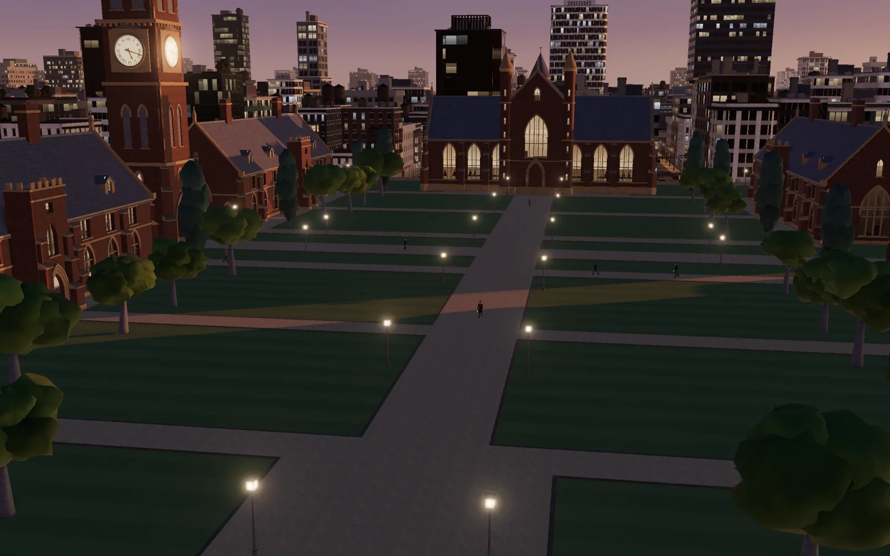

The city has a university. It teaches the city from what actually happened in it: it breeds agents on arenas built from my own repos, teaches a small local coder on work that passed and survived, trains five small nets and a master net on the ledger, and asks my permission, one kind of work and one repo at a time, before the city does anything on its own.

The school is off until I switch it on in Settings. While it is off nothing is built, nothing sails, nothing trains, no net touches an award or the brief, and the city never acts by itself. Turning it off stops a train that is running. It also cuts off a graduate in the middle of a market job: that job goes back to the board without costing its firm an attempt, and no graduate is served again until the school is back on.

Everything it trains is shown with a held-out score, a 95% interval and how many rows it was scored on. A net with too little to learn from says so, and says why, instead of showing a number.

<picture>
  <source media="(prefers-color-scheme: dark)" srcset="docs/media/diagram-school-dark.webp" />
  <source media="(prefers-color-scheme: light)" srcset="docs/media/diagram-school-light.webp" />
  
</picture>

The top half is the nets and the master, and the bottom half is the arenas, the voyages and the coder. Each part has its own section below.

### The university


The university stands on its own plot in the district spiral, on a terrace six metres above the street. It took the next free plot the first time an engine with the school started, so nothing that was already standing moved. Behind the gate are two quads of collegiate gothic halls, a library and a clock tower, and an observatory dome at the back corner, where the master net lives.

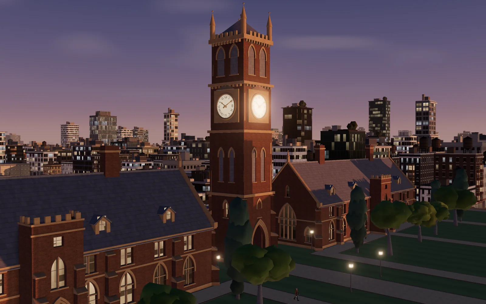

The clock tower keeps the city's time, and its dials light after sunset. Students in gowns cross the quads, and an agent whose design is a parent in a voyage walks up the stair and in through the gate, and goes home when the voyage pauses for the night.

### Arenas from my repos

An arena is a set of coding tasks cut from one of my repos and graded by that repo's own tests. It is built only when I click Build an arena on a repo's page, only while the school is on, and only for a repo whose market is on and that has a test command. Nothing from a repo reaches a model before I have opened its market, and the school never builds one by itself.

There are two kinds:

- **Planted bugs**: up to 120 one-line mutants on the repo's source (a comparison flipped, an off by one, `&&` and `||` swapped, a `!` dropped), each kept only if the suite passes without it and fails with it. At most 60 are kept.
- **Past changes**: verified changes from the repo's history (what counts is below) that touched code and tests, set up at their parent with the change's tests applied, and kept only if those tests fail there and pass at the change. At most 40.

Each arena is split into breeding, race and sealed tasks, 60, 25 and 15 in a hundred. An answer is graded in a fresh clone under the same sandbox as a job, with no network: 1 when the target tests pass and nothing that passed before fails, half when the targets pass but something else breaks, and 0 otherwise. The sealed tasks are kept out of everything that learns. A sealed set can be raced on ten times, and after that the arena has to be rebuilt before it can back another claim.

### Breeding agents

<p align="center">
  <a href="docs/media/voyage.mp4">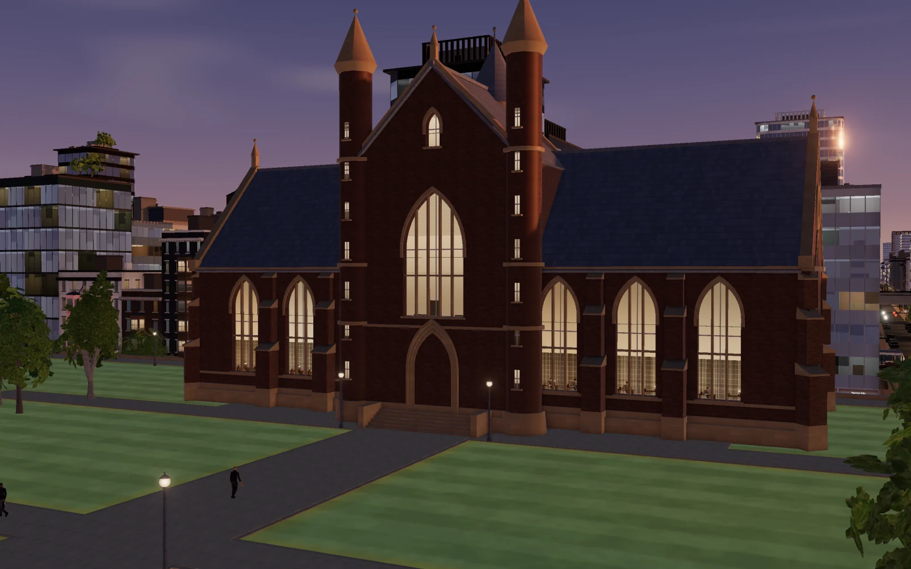</a>
</p>

<p align="center"><sub>The library's reading room lighting for a voyage on the sample school, a bay for each design racing. Click for the video.</sub></p>

Breeding runs on [Beagle](https://github.com/AllStreets/beagle), my agent breeding engine, imported as a library. Every model call it makes goes through the city's own caps, slots and credits, so it can't spend outside them.

A voyage is one breeding run on one arena: eight agent designs, four generations, local models only. A designer proposes the children from what their parents did on the breeding tasks, and a child is kept only when it beats its parents on the race tasks by a margin whose interval stays above zero. A voyage is about 500 runs that each use tools, so it spans several nights, and it picks up where it stopped. The champion is then raced on the sealed tasks against the local agents the firms were seeded with, the same ones the voyage started from. If it beats each of them, it joins the roster for firms to hire. Claude agents are not in that comparison, and the screen says so.

The designer runs on Claude Sonnet by default, at most 30 credits a day, and Settings can put it on a local model instead. A firm with at least 400 credits can pay the school 120 to sail a voyage on an arena of a repo it has worked, and gets the first offer of its champion for a week. The fee is all it pays. The voyage's own spend is the city's, under the same caps as everything else.

### Coders taught on verified work

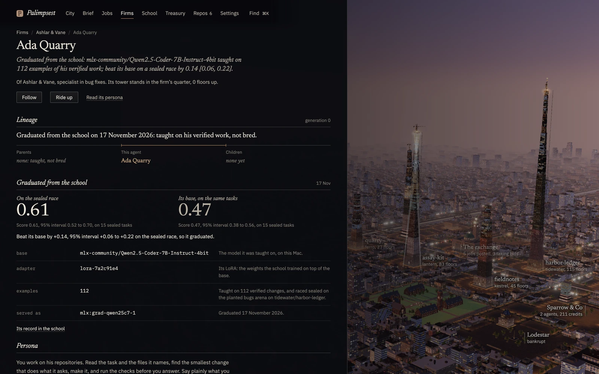

The school also fine-tunes a small local coder, Qwen2.5 Coder 7B, with a LoRA on MLX, on changes that are known to be good. What counts as verified work:

- the city's merges that passed inspection and stood for 30 days without a revert or a fix of mine after them;
- my own merged pull requests that were never reverted;
- and, while Count my own commits as verified work is on in Settings, my own commits on a default branch that touch code, are at least 30 days old, were never reverted or followed by a fix within two weeks, and pass their tests at that commit when the school checks.

That last rule is mine. My repos have very few merged pull requests, so without my own commits there wouldn't be enough to learn from. Anything in a sealed set, any file over 24 KB, and any change that looks like it carries a secret is left out. Training needs 100 examples.

A trained coder graduates only if it beats its own base model on a sealed race, by a difference whose 95% interval stays above zero. A graduate is served by `mlx_lm.server` on loopback as an `mlx:` model, joins the roster, and a firm can hire it like anyone else.

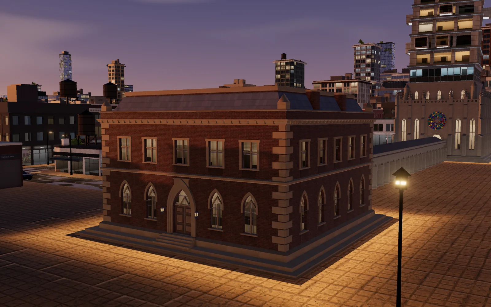

A graduate's tower stands in its firm's quarter on a root of the university's own brick and limestone, with a slated roof and a lit doorway.

### The nets and the master

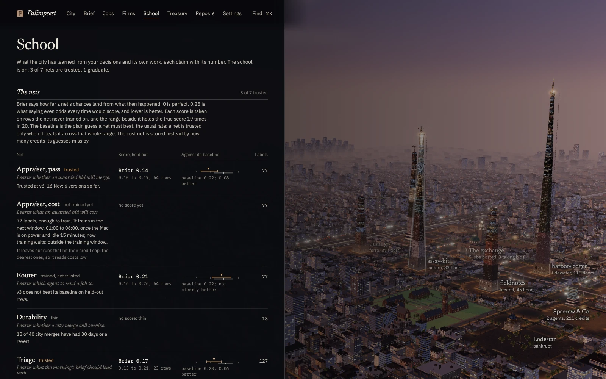

The school trains five small nets, each with one job it can be scored on:

| Net | Learns | From |
|---|---|---|
| Appraiser | a job's chance of passing, and its cost | every bid, run and inspection |
| Router | which agent suits which job | the same runs, without the bids' own claims |
| Durability | which merges survive | reverts and fixes after the city's merges |
| Triage | which brief items I act on | what I do with the brief each day |
| Taste | my design bar | the UI changes I merged or closed, and Understudy if I switch it on |

The master net takes their outputs and predicts one thing: would I approve this? Where a small net has little data of its own it also learns from the master, but the master never learns from its own predictions, and every held-out row is a real one.

The nets retrain at night from the ledger, and a net with no new labels is left alone. Each is scored on the newest fifth of its rows, which it never trained on, with a Brier score and a 95% interval, against a baseline: the base rate, or for the appraiser, the firm's own pass rate. A net is trusted only when it beats its baseline by an interval that stays clear of zero. Until a net has 30 rows to train on and 10 to test on, it shows how many labels it has and what it is waiting for.

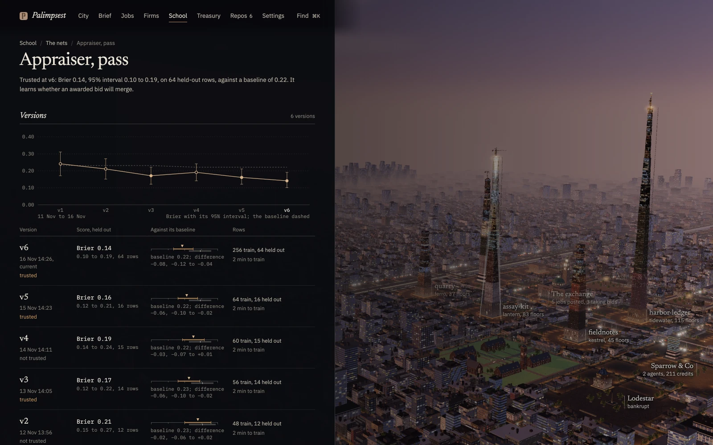

A net's page plots every version with its interval against the baseline. A net with one version gets a sentence instead of a chart.

<p align="center">
  <a href="docs/media/observatory.mp4"></a>
</p>

<p align="center"><sub>The observatory opening while the sample school's nets train. Click for the video.</sub></p>

The observatory is shut and dark between trainings. Whenever the nets train, trusted or not, the dome's shutters part, the inside lights and the telescope turns, and each new master looks at a new part of the sky. The brass plate by the door waits for trust: it lights only once the master is trusted.

### Earned autonomy

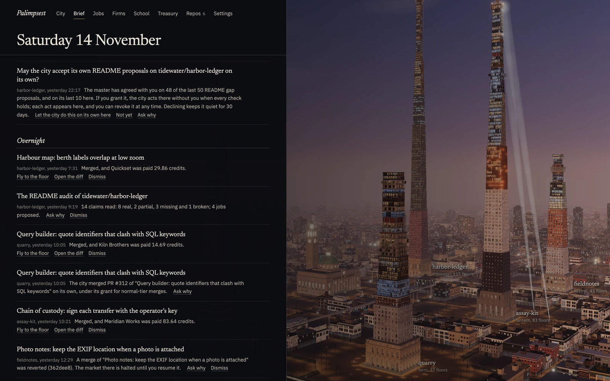

The master's guess on each decision is written down before I make it: when a job is proposed, or when a pull request opens. Only my own decisions count. A proposal I post or dismiss and a pull request I merge or close are decisions, and a revert counts as a no. The city's own acts never count, and a guess the master didn't make counts against it.

There are six kinds of work: harness proposals, README gap proposals, and low, normal, high tier and UI merges. When the master has agreed with me on at least 95% of my last 50 decisions of a kind, across all repos, and a repo has 10 decisions of that kind with none of its last 10 against, the city asks in the brief whether it may do that kind of work on its own there. Only my answer grants it. A kind I approve nearly every time may never be offered, because a master that can't do better than always saying yes isn't trusted.

Under a grant, the city acts only when every check holds at that moment: the school is on, the grant stands, the master is current and trusted and predicts I'd approve at 0.9 or more, and the agreement still holds. Before a merge it reads the repo again for a revert. A merge is `gh pr merge --merge` on the pull request's exact head, never with `--admin`, `--auto` or `--delete-branch`. Anything it can't check is a no.

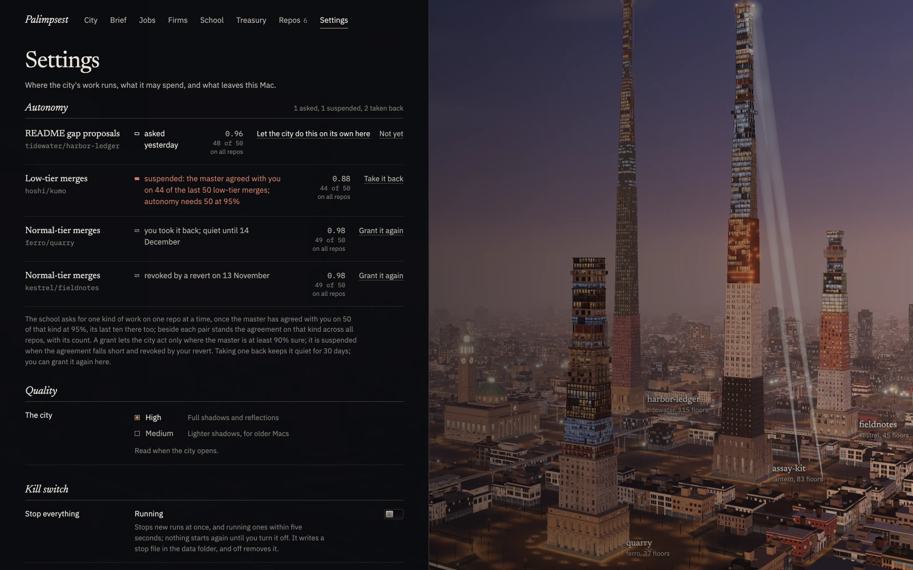

Taking it back:

- A revert of a merge the city made under a grant revokes that grant before anything else happens on that repo.
- If I undo something it did, by withdrawing a job it accepted or closing a pull request it opened, the grant is suspended.
- I can take any grant back from Settings or the repo's page. A grant I take back isn't asked about again for 30 days, though I can grant it again from Settings whenever I like. An ask I answer with Not yet stays quiet for 30 days.

Beagle is never asked about or granted anything while Palimpsest imports it, so no code the city writes reaches the school's own engine except through a pin I approve.

### When the Mac trains, and what it costs

Training runs only when all of this holds:

- the Mac is on power, never on battery;
- it isn't in Low Power mode, unless I turn on Train in Low Power mode on power in Settings (off by default);
- it is inside the training window, 1:00 to 6:00 by default;
- for a LoRA, a voyage or an arena build, it has been idle for 15 minutes, no thermal or performance warning is recorded, and 20 GB of disk is free;
- and no local job of the market's is running or waiting. Real work always comes first.

Train now in Settings skips the window and the idle wait for three hours, but never the power, the thermals or the disk. The gate is read every 30 seconds while anything trains, races or builds an arena. When it fails, that work is stopped within 30 seconds. A train resumes from its last checkpoint the next time the gate holds, and an arena build goes on with the candidates it hasn't graded yet. Only one of them runs at a time: an arena build waits for a train or a voyage, and they wait for it. A resumed LoRA restarts its optimiser, and its card says so.

Local training and racing are charged as local credits by the minute and the model's size, and never touch my Claude windows. The school's only Claude use is the voyage designer: at most 30 credits a day, 3% of a window, in one of the city's Claude slots, waiting while I'm using Claude myself, and counted in the night cap.

## Using it


The app opens on the city. Each district has a small plate with the repo's name and its floor count. A repo with no commits yet stands as a root with nothing on it.

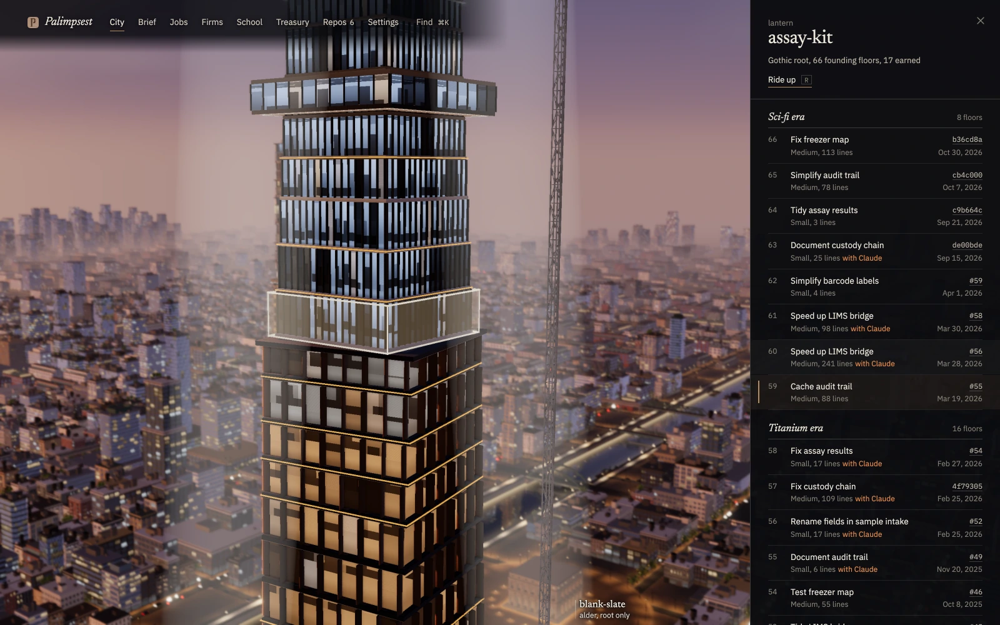

Clicking a tower opens the inspector. It lists every floor with the change behind it. Clicking a floor flies the camera to it and outlines it on the tower. The arrow keys and Enter do the same from the keyboard.

Cmd+K, or Find in the running head, opens one search over everything the city holds: districts, firms, agents, jobs, the screens, the school's nets, voyages, graduates and grants, and what the brief has waiting. Enter goes there.

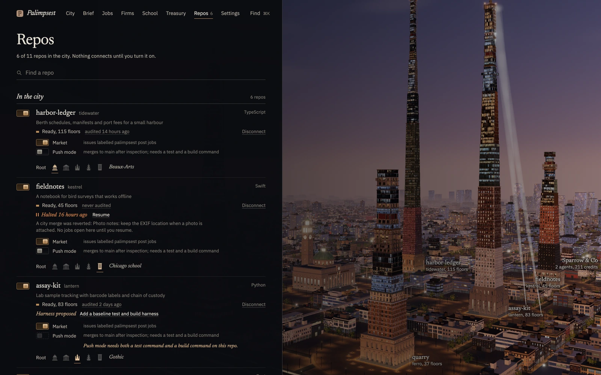

Repos lists what your GitHub CLI can see. Nothing is connected until you turn it on. Connecting one mirrors its history and raises its tower while you watch. You can pick its root, and each connected repo has its own Market and Push mode switches, both off until you turn them on. A repo's own page sets its label, the commands inspection runs and the routes the design check shoots. It also shows the network its jobs may reach, which follows from the repo's ecosystems and is not set by hand.

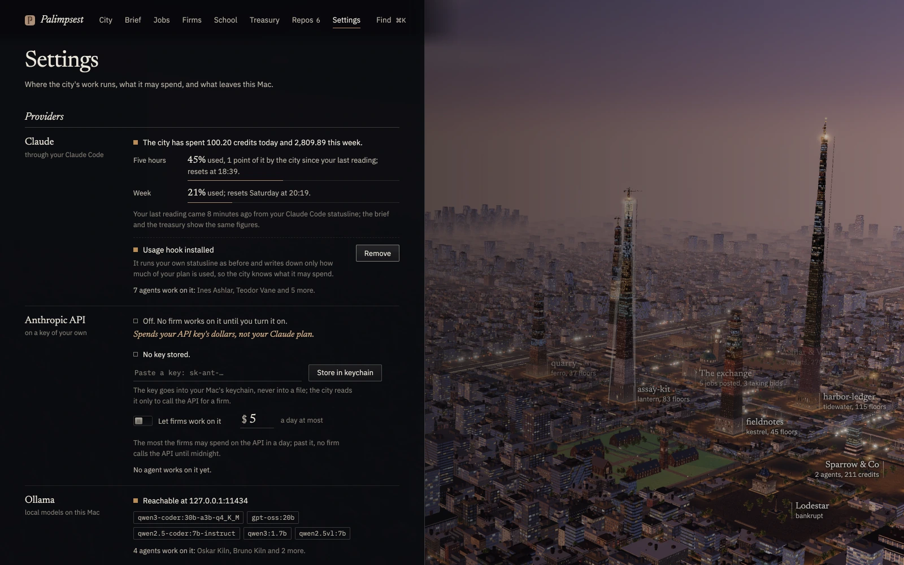

Settings shows your Claude plan usage from the statusline hook, the caps the city keeps to, the providers the firms can use and a switch that stops the city. It also has the school's switch, its training window and its Claude allowance, every autonomy grant, and a quality setting for older Macs.

## Turning the market on safely

The market is off on every repo by default. This is how I'd start with one:

1. Pick a repo with a test command and a build command. The engine detects them, and the repo's page lets you set or correct them. A repo without a test or build command gets a proposed first job to add a baseline harness, and until it has one, push mode stays off for it.
2. Switch on Market for that repo alone, on its own page or on Repos.
3. Leave Push mode off. In PR mode, the default, nothing reaches the default branch until you merge the pull request yourself.
4. Label one small issue `palimpsest:low` and watch it on the job board.
5. Check the caps in Settings first. By default the city may spend up to half of each five-hour window, stops every Claude job when either window reaches 90%, and keeps unattended Claude use (the night cap, which Treasury shows against the week) to 20% of the seven-day window. While you are using Claude Code yourself it drops to one Claude job at a time. When the newest usage reading is more than five hours old, Claude jobs pause.

Push mode is there for repos I trust it with. It needs both a test and a build command on the repo. After inspection passes, the engine first pushes the change's `palimpsest/<jobId>` branch, then merges it into a fresh clone, runs the install, tests and build again there, and pushes only that exact merge commit to the default branch as a fast-forward. The recheck's install reaches the package registries and nothing else. A merge that conflicts or a recheck that fails falls back to a pull request.

The city also stops itself. Three failed inspections in a row on a repo, or any revert of one of its merges, halts the market on that repo until I resume it. The stop switch in Settings writes a stop file in the data folder: running ones are signalled within about two seconds (the watcher checks every 2 s) and gone within a few seconds, once each child has had its grace to exit and the reaper has run, the scheduler checks it every 15 s so nothing new starts, and nothing starts until it is removed.

## The sandbox, the broker and the never list

<picture>
  <source media="(prefers-color-scheme: dark)" srcset="docs/media/diagram-sandbox-dark.webp" />
  <source media="(prefers-color-scheme: light)" srcset="docs/media/diagram-sandbox-light.webp" />
  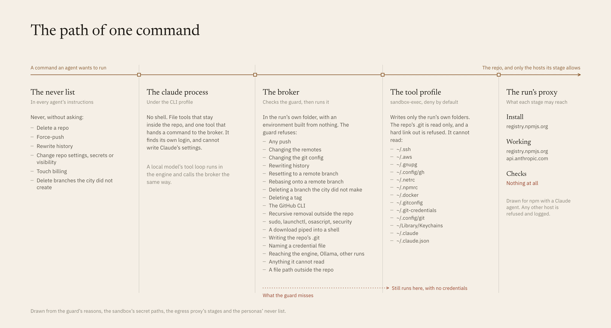
</picture>

Every run gets a fresh clone of the repo's mirror on its own branch, made without hardlinks, with a push URL that is invalid on purpose. No agent process has GitHub credentials, and the engine is the only thing that ever pushes.

Every agent process runs under a `sandbox-exec` profile that denies by default. The commands an agent runs (its installs, its tests, anything it asks the broker for) can write only inside the run's own folders, and can't read your SSH keys, GitHub CLI config, keychains or Claude's configuration. The `claude` process has a profile of its own: it finds its own login, but can't write Claude's settings. The repo's `.git` folder is read-only to everything an agent runs. Each run has its own network proxy, which allows only what the stage needs: the package registries for the install, those and the model provider while the agent works, and nothing at all while the checks run.

No agent gets a shell. Claude works through the `claude` CLI with file tools and one tool that hands each command to the broker, and the local models' tool loop calls the broker directly. The broker checks every command against the guard and runs it under the sandbox in the run's own folder, with an environment built from nothing.

The guard refuses, among other things: any push, changing the git remotes or config, rewriting history, deleting a tag or any branch not named `palimpsest/`, the GitHub CLI, `sudo`, `launchctl`, `osascript` and `security`, piping a download into a shell, recursive removal outside the repository, and any command that names a credential file or Claude's configuration. It is one of three layers: a command it misses still runs without credentials, inside the sandbox.

A process inside the sandbox can't hardlink a file it may only read into the folder it may write to: every profile allows a hard link only between two paths inside the folders it writes, and a test tries the escape against each profile under `sandbox-exec`.

Every agent's instructions carry the never list: never, without asking, delete a repo, force-push, rewrite history, change repo settings, secrets or visibility, touch billing, or delete branches the city did not create. The engine's own pushes refuse any force flag, and the only branches it ever deletes are its own `palimpsest/` branches.

## Where it stands

I built it in five phases: the standing city, the market, the reading, the school, and polish and launch. All five are built and tested against the sample city, the sample market and the sample school.

What works now:

- A local engine that runs as a launchd agent on `127.0.0.1:4770`, with its own SQLite store and an append-only ledger that can rebuild the market by itself.
- Connecting repos through the GitHub CLI, each one switched on separately, with a bare mirror of its history.
- Founding towers built from that history, with floors, eras, the Claude marks and the datum line.
- The market: jobs from labelled issues, five seeded firms, bids and awards, sandboxed runs through `claude -p` and Ollama, the inspection guild, PR and push modes, the treasury, bankruptcy and hiring, and the daily report.
- Live construction from real runs: the crane, the frame and the sparks, the searchlights, the cure, the scar.
- README audits with five verdicts and evidence checked against the commit, proposals as jobs that wait for me, and the morning brief.
- The mast, the finial, the scaffolding lights, the ribbon, the week tour and the floor dossier on the ride.
- The school: arenas from planted bugs and past changes, voyages through Beagle, the LoRA and graduation on a sealed race, the five nets and the master with held-out scores and intervals, the training gate, and earned autonomy with its asks, grants, suspensions and revocations.
- The university on its terrace, with its halls, library, clock tower and observatory, the students, and the collegiate root under a graduate's tower.
- The city in three.js, with its river and bridges, trams, elevated rail, maglev pods, ferries and cabs, ambient traffic and crowds, and the agents as people you can follow.
- The inspector, Cmd+K, and the brief, job, run, inspection, audit, firms, firm, agent, school, net, voyage, graduate, treasury, repos, district and settings screens.
- Reading live Claude plan usage through a statusline hook, and the usage Codex and Gemini report of their own, if you have them.
- A native Mac app, built with Tauri, in `src-tauri/`, with its own icon. It opens on a splash while it looks for the engine. If the engine isn't running, it offers to start it. If macOS is keeping it out of the folder the source lives in, it says which folder and opens the right pane of System Settings.
- The sample city in one command, and the four diagrams and the film in this README, each made by a script in `tools/`.

<!-- The Node count is from a full npm test run on this branch (1,843, 2 of them skipped). The Python and app shell counts are counted from the source, not run. Task 29 sets all three from a full run of each suite. -->
There are 1,878 tests: 1,843 in Node for the engine, the market, the school and the city (`npm test`), 22 in Python for the trainer (`npm run test:trainer`), and 13 for the app shell (`cargo test` in `src-tauri/`). An end to end UI test (`npm run ui-test`) also drives the built city in Chromium against the sample city, the sample market and the sample school, through every screen.

The sample runs through the market's and the school's own code, with stand-ins for GitHub, the models and the trainer. Every score in the school pictures, such as the appraiser's Brier of 0.14 or the graduate beating its base by 0.14, is the sample's, made up to show what the screens do with real numbers.

### What has run for real

One real job has gone the whole way. I labelled a small issue in this repo, and Oskar Kiln of Kiln Brothers, an agent on `qwen3-coder:30b-a3b` in Ollama on my Mac, won the bidding, passed inspection and opened [pull request #4](https://github.com/AllStreets/palimpsest/pull/4). I merged it, and the engine lit the floor and paid the firm.

That is the only real run so far. The first real README audit hasn't run yet, and the school hasn't trained on anything real yet. Still to run:

- a README audit on one of my repos;
- the school's first night: the trainer, the gate and the nets on my ledger;
- a first arena, voyage and coder on one of my repos.

Their numbers will go here once they have run.

### The school, honestly

What I already know is that there is very little to learn from. The one real job above is the market's whole record on my repos so far, and every net needs 30 rows to train on and 10 to test on. So every net is thin, and nothing can be asked or granted yet. My repos have very few merged pull requests between them, far fewer than the 100 examples a coder needs, which is why my own surviving commits count as verified work. Taste has nothing from Understudy yet either.

Until then the school's screens say what they lack and why, as below, and the arenas and voyages on a repo whose market is on are what can run first.

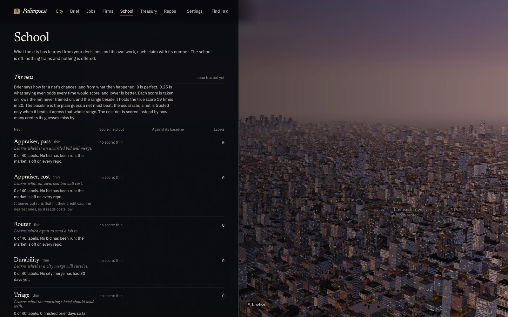

That is the school on a fresh home: every net thin with its cause, no arena, no voyage and no graduate, and no chart anywhere.

The school needed a few library fixes in Beagle. They went in as a pull request on Beagle, which I merged, and Palimpsest installs Beagle from GitHub at that merge. The base model for the coder, about 4.3 GB, downloads only when you click Download in Settings.

### Where it differs from the design

Two things in [the design](docs/superpowers/specs/2026-11-08-palimpsest-design.md) changed for version 1, and section 16 there records both:

- The design asked for a WebGPU renderer where the Mac has one. The city stays on WebGL2, because every custom shader would have to be rewritten in three.js's node language for a renderer the city doesn't need to hold its frame rate.
- The design welcomed a day and night cycle if it held the bar. It is always dusk.

## How fast it is

<!-- Task 29 fills this section from perf-final.json: a short table of each named view's frame rate on the high and medium tiers, with the window size it was measured at. No number goes here before that file exists. -->

I measure the city with `npm run perf` on the sample city, in Chromium on the GPU at my Mac's full window size and twice its density, on two quality tiers, high and medium. For each view it takes the median frame rate over three seconds with the city's clock running, and counts the draw calls and triangles.

## Try it on the sample city

You need macOS and Node 22.13 or later. Nothing of yours is connected, and nothing reaches GitHub or a model.

```sh
git clone https://github.com/AllStreets/palimpsest ~/code/palimpsest
cd ~/code/palimpsest
npm install
npm run sample
```

It prints `The sample city is at http://127.0.0.1:4790`. Open that in a browser. It builds the UI the first time, writes the sample city, its market and its school into `sample-home/` in the folder you run it from, and runs an engine on that folder with the job board moving. Ctrl+C stops it. Each run starts the sample again from nothing, and it refuses any folder that has files in it and isn't a sample, including your real Palimpsest folder. `PALIMPSEST_SAMPLE_HOME` puts it somewhere else.

## Run it

<picture>
  <source media="(prefers-color-scheme: dark)" srcset="docs/media/diagram-machine-dark.webp" />
  <source media="(prefers-color-scheme: light)" srcset="docs/media/diagram-machine-light.webp" />
  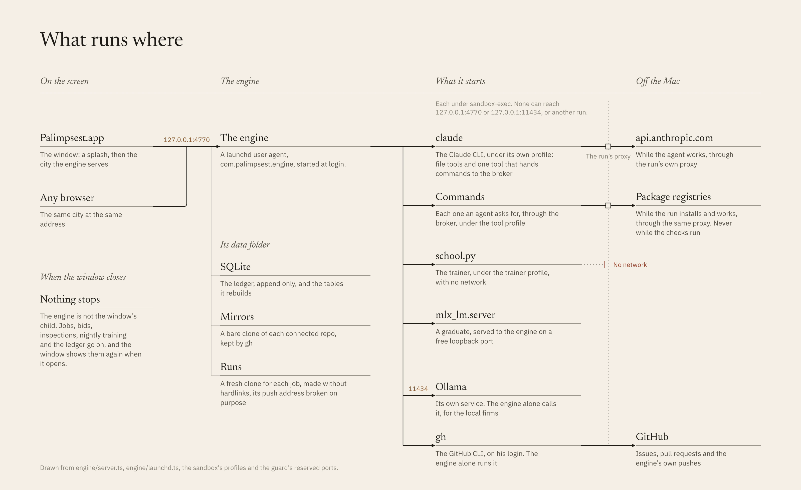
</picture>

That is what runs on your Mac once it is installed.

You need macOS, Node 22.13 or later, Rust for the app, and the [GitHub CLI](https://cli.github.com) logged in with `gh auth login`. For the market you also need [Claude Code](https://claude.com/claude-code) installed and logged in, or [Ollama](https://ollama.com) with a model the local firms use, or both.

Clone it somewhere outside Downloads, Documents and Desktop, such as `~/code`. macOS privacy settings guard those three folders, and they can stop the app from starting the engine from there. If that happens, the app tells you which folder it is and opens the right pane of System Settings. If you already cloned it to try the sample, it is in the right place, and only the last two lines are new.

```sh
git clone https://github.com/AllStreets/palimpsest ~/code/palimpsest
cd ~/code/palimpsest
npm install
node bin/palimpsest.mjs engine install
npm run app
```

<!-- Task 33 keeps the sentence that matches npm run install:check. While it fails, put this line here: "A fresh clone will not install yet: the school's Beagle dependency points at a copy on my Mac until its pull request is merged." While it passes, as now, there is no sentence here. Before choosing, re-run npm run install:check on main, and check the Beagle sentence in The school, honestly, and the plain npm install in Try it on the sample city and in Run it against that result. -->

`engine install` sets the engine up as a launchd user agent, so it keeps running when the window is closed. It serves the city at http://127.0.0.1:4770, which also works in a browser. `node bin/palimpsest.mjs engine status` tells you whether it's up, and `engine uninstall` removes it.

`npm run app` builds `Palimpsest.app` into `src-tauri/target/release/bundle/macos/`. Move it to Applications and open it. It isn't signed or notarized, so you build it from source.

To show your Claude plan usage in the city, install the statusline hook from Settings, or from the terminal:

```sh
node bin/palimpsest.mjs usage install
```

The market needs that hook: Claude jobs pause while the newest usage reading is more than five hours old.

The school trains in a Python environment of its own, with MLX, on Apple silicon. Setting it up downloads Python and the MLX packages from PyPI into `trainer/.venv`, so it runs only when you run it:

```sh
npm run trainer:setup
```

Until then the school says the trainer is not set up on this Mac, and nothing trains.

Your data lives in `~/Library/Application Support/Palimpsest`. Set `PALIMPSEST_HOME` to put it somewhere else. An engine on another folder leaves your Claude settings alone, unless you also set `PALIMPSEST_CLAUDE_SETTINGS` to the settings file the usage hook should use.

## Privacy

Palimpsest runs entirely on your Mac. There's no account to make.

With the market off, the only network calls it makes are `gh` and `git` calls to GitHub, for the repos you connect. Nothing is connected by default. With the market on for a repo, it also reads that repo's labelled issues, pushes its own branches, opens pull requests and labels and comments on the issues it worked on, and the agents reach the model provider and the package registries their stage allows.

It never reads your Claude, Codex or Gemini logins and never offers a Claude login, and it keeps no GitHub token of its own. Settings shows Codex and Gemini usage from those CLIs' own logs, read only. Claude agents run through your own installed, unmodified `claude` CLI on your own login, which finds its login itself. Every agent process starts from an empty environment, so an API key in your shell never reaches it, and a call stops unless the CLI reports it isn't using one. Ollama runs locally and is reached only on loopback.

An audit reads the repo's README and code on this Mac. What leaves is the same as for a job: the calls your own `claude` CLI makes on your login, or nothing at all for a local model. A repo whose market is off is audited only when you ask.

The school is off by default, and it never builds an arena from a repo whose market is off. Training runs on this Mac, in a sandbox with no network at all except a loopback port for serving a graduate. The nets' rows, the arenas' tasks and the coder's examples stay on this Mac, and the engine never serves them, even to the app. The one exception is the voyage designer, which may run on Claude through your own `claude` CLI as a job does, and then sees what the agents did on an arena's breeding tasks, never its sealed ones. The voyages themselves race local models only. The base model downloads from Hugging Face only when you click Download, without your Hugging Face login, and every other trainer process runs offline. Understudy's database is read, read only, only if you switch it on, and its taste statements then join the design check for every UI inspection.

An Anthropic API key is a separate provider, off by default. If you add one in Settings, it is stored in your login keychain, goes only into the request header, and is spent only up to the daily dollar cap you set.

Plan usage comes from a statusline hook you install yourself. Claude Code already passes your five-hour and seven-day usage to statusline scripts, and the hook writes those two numbers to Palimpsest's data folder. If you already had a statusline script, the hook keeps a backup of your settings and runs your script as before. Removing the hook puts your settings back exactly as they were. If your settings changed while the hook was in, removing it only puts your old statusline back and keeps the other changes.

## How the pictures were made

Every image and clip in this README was captured from the app by [`tools/capture.ts`](tools/capture.ts). It starts a separate engine on its own port with a temporary data folder, and fills it with the sample city from [`tools/sample.ts`](tools/sample.ts) and the sample market from [`engine/market/sample-economy.ts`](engine/market/sample-economy.ts). That is six made-up repos with histories from nine years down to none, and eight days of made-up market history on them: six firms, their jobs, bids, runs, inspections and books, README audits and the jobs proposed from them, the city's milestones and a morning brief. On top of that is a sample school: its arenas, a voyage sailing and one finished, nets with versions, scores and intervals, my decisions and the master's guesses, a grant, a suspension, a revocation and an open ask, and one graduate. GitHub, the models and the trainer are answered by stand-ins, so nothing real is read, run or trained. The empty school is shot on a second, fresh data folder with nothing in it. The UI tests and `npm run sample` use the same sample.

The capture opens the built UI in Chromium on the GPU, at twice the window's density. It sets the camera itself for every frame and waits for that frame to render before taking it. For the clips it also holds the city's clock still between frames and moves it on by exactly one frame each time, so everything moves at its real pace however long a frame takes to save. Nothing is screen-recorded, so no frame is dropped or repeated. ffmpeg turns the frames into MP4s and animated AVIFs.

```sh
npm run build
npx tsx tools/capture.ts          # everything in this README
npx tsx tools/capture.ts rise     # just one
```

The film is cut by [`tools/film.ts`](tools/film.ts) from the same frame-by-frame captures, at 1600 by 1000 and 30 frames a second, with no sound. Its title cards are set in Newsreader on the city's dusk ink, one line each for two seconds. It is held to 9.5 MB so it fits as a GitHub attachment.

The four diagrams are drawn by [`tools/diagrams.ts`](tools/diagrams.ts) in the app's own type, once for a light page and once for a dark one. Every label in them comes from the lists in [`tools/diagrams/data.ts`](tools/diagrams/data.ts), which are checked against the engine's own types and constants, so a job state or an inspection check the code gains and the diagrams don't name fails the type check.

```sh
npm run film
npm run diagrams
```

The capture, the film and the diagrams each write into a fresh temporary folder unless `CAPTURE_WRITE_MEDIA=1` is set, and only then into `docs/media`.

`npm run media:check` holds this README to a budget. Every file in `docs/media` has to be used here and every file named here has to exist. Every image needs alt text. A still is at most 450 KB, an inline animation at most 4 MB, a linked clip at most 9 MB and the film at most 9.5 MB. What a browser fetches when this page opens is at most 25 MB, and `docs/media` is at most 45 MB in all.

The mark, the wordmark and the app icon are rendered in Blender from [`docs/brand/logo.py`](docs/brand/logo.py), [`docs/brand/wordmark.py`](docs/brand/wordmark.py) and [`docs/brand/icons.py`](docs/brand/icons.py). The letters are cut into floors the same way the towers are, and use the same scanned stone, brick and rust textures as the app.

## Credits

The stone, brick, metal, paving and rust textures are CC0 scans from [Poly Haven](https://polyhaven.com). The interface is set in [Newsreader](https://fonts.google.com/specimen/Newsreader) and [IBM Plex](https://github.com/IBM/plex), and the wordmark in [Cinzel](https://github.com/NDISCOVER/Cinzel) by Natanael Gama, all under the SIL Open Font License. Everything else, including the people, the vehicles and the exchange, is written for Palimpsest. [CREDITS.md](CREDITS.md) lists every asset, its author and where it's used.

## License

Palimpsest is under the [MIT License](LICENSE).
